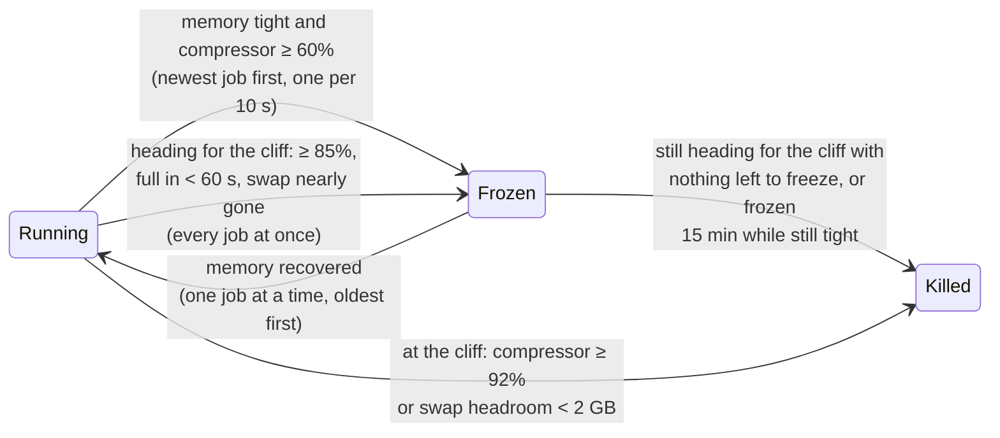

<p align="center">
  <picture>
    <source media="(prefers-color-scheme: dark)" srcset="assets/logo-dark.svg">
    <source media="(prefers-color-scheme: light)" srcset="assets/logo-light.svg">
    
  </picture>
</p>

<h1 align="center">membrake</h1>

<p align="center">
  <b>A memory brake and queue for macOS.</b><br>
  Queues heavy dev and coding-agent jobs until there is memory for them, freezes runaway ones
  before your Mac freezes, and kills only at the cliff.
</p>

<p align="center">
  <a href="https://github.com/DivMode/membrake/actions/workflows/ci.yml"></a>
  <a href="LICENSE"></a>
  
  <a href="https://builtwithnix.org"></a>
</p>

<p align="center">
  
</p>

---

## Why

Run enough parallel work on a Mac and it stops responding. Not slowly: the
cursor freezes, apps beachball, and eventually the only way out is the power
button.

We hit this on a 96 GB Mac Studio running ten coding-agent sessions and four
self-hosted CI runners. Between them they started **31 TypeScript type-checkers,
8 linters and 92 Node processes at once**. macOS compressed what it could,
swapped 75 GB to disk, and then started killing processes to survive. Its own
crash reports show exactly what it chose:

| Killed by macOS | Not killed |
|---|---|
| **2,745 processes** in one event, every one an idle system service (keychain, iCloud, accounts, Do Not Disturb, …), reason `low-swap` | **All 131** type-checkers, linters and test workers that were eating the memory |

The Mac never recovered. It had to be restarted, and everything open was lost.

### Why macOS does that

macOS ranks processes into *jetsam bands*. When the memory compressor or swap
runs short, the kernel only kills processes in **band 0** (idle daemons). A
command you start from a terminal, or that a coding agent starts for you, sits
in band 180 and is never chosen, unless a single process holds more than half
of all compressed memory. A pool of thirty similar workers never qualifies.
Apple Silicon kernels also compile out thrashing detection.

Linux solved this years ago with [earlyoom](https://github.com/rfjakob/earlyoom)
and systemd-oomd. macOS ships nothing equivalent, and the obvious knobs don't
help:

- **`nice`, QoS classes, `taskpolicy`** order the CPU, not memory.
- **The memory-pressure level** (Activity Monitor's green/yellow/red) ignores
  swap. It can read *normal* while the machine is thrashing.
- **`ulimit` RSS limits** are not enforced on macOS.
- **A fixed concurrency cap** wastes memory when the machine is idle and still
  swaps when the jobs are bigger than you guessed.

## How it works

membrake is a small daemon that samples the kernel once a second. It is a queue
and a brake, working from the same view of memory:

- **The queue** keeps heavy commands from starting into a Mac that has no room for
  them. Run a type-check, a test run or a build as `membrake exec -- <command>`
  and it waits in line until there is memory for it, then starts. Admission is by
  memory, not by a fixed count. See [Queue](#queue-membrake-exec).
- **The brake** deals with memory that runs short all the same: it freezes runaway
  jobs before the Mac freezes, and kills only at the cliff.

They are one ordered system: while the brake holds a frozen job the queue admits
nothing, so frozen work comes back before new work starts.

Both act on **jobs**: process groups, which is how shells and coding agents start
every command. A type-check, a test run or a build, with all its workers, is one
job. The rest of this section is the brake.



1. **Brake.** When memory is genuinely tight and the compressor is filling, it
   freezes (`SIGSTOP`) the **newest** eligible job, then another every 10 s
   while memory keeps climbing. A frozen job stops growing; its memory is
   compressed or swapped once instead of thrashing, and nothing is lost.
2. **Brake hard.** If the Mac is heading for the cliff (compressor ≥ 85%, full
   in under a minute, or swap almost out of room), it freezes **every** running
   eligible job at once, even in the middle of the 10 s pause that follows an
   earlier freeze. Freezing is instant and loses no work, so it always comes
   before killing.
3. **Release.** When memory recovers, it resumes frozen jobs one at a time,
   oldest first, so the newest (the likeliest runaway) comes back last and they
   don't all regrow at once.
4. **Stop.** Only when the Mac is still heading for the cliff with nothing left
   to freeze, or is already at it, it kills the **biggest** eligible job, frozen
   jobs first. A job that has been frozen for 15 minutes while memory is still
   tight is killed too, whatever else is going on.
   - Heading for the cliff: `SIGSTOP`, then `SIGTERM` and `SIGCONT` so the job
     can shut down, up to 5 s of grace (`--term-seconds`), then `SIGKILL`.
   - At the cliff (compressor ≥ 92%, or swap headroom under 2 GB, with memory
     tight) the Mac has seconds left, so there is no grace by design: `SIGSTOP`,
     then `SIGKILL` at once, with no `SIGTERM`.

### What it watches

| Signal | Source | Why this one |
|---|---|---|
| Compressor occupancy | `vm.compressor.segment.*`, `vm.compressor.pages_compressed*` | The real cliff: the kernel declares memory exhausted at 98% |
| Time to full | Occupancy over the last ~10 s | Catches fast fills while occupancy is still moderate |
| Swap headroom | `statfs` on the swap volume, `vm.swapusage` | The second cliff: swap can't grow on a full disk |
| Free memory | `kern.memorystatus_level` | Gates the compressor signals: segments are freed lazily, so occupancy alone lies after a crunch |
| Pressure level | `kern.memorystatus_vm_pressure_level` | Backstop only |

### What it never touches

- Apps, app extensions and XPC services (anything inside a `.app`, `.appex` or `.xpc` bundle).
- System processes and system users (a uid below 500, unless you name the
  account with `--include-user`).
- Groups that mix users, or include a system user's process (a `sudo` inside
  a build, say).
- The coding agents themselves (`claude`, `codex`), terminals and multiplexers.
  Any process in a group counts, judged by its name, its path and its complete
  command line, so an agent run by an interpreter (`node …/codex`) protects the
  shell-led group it is part of.
- Anything it cannot inspect in full. A group with a process whose owner, path
  or arguments cannot be read is left alone.
- Users you protect with `--protect-user` (for example your CI runner account):
  never frozen, killed only if nothing else is left. This only ranks jobs that
  are eligible already; it does not make a system account's jobs eligible.

Eligibility is checked again on the group as it is, not only when it was
scanned: after the record of a stop is written and just before the `SIGSTOP`,
whether it starts a freeze or a kill, and before every later pass of signals
(`SIGTERM`, each round of `SIGKILL`). A job that has become ineligible since (it
started an agent, say, or a helper from another user joined it) is not stopped
or killed, and is continued if it was frozen.

### Built to be trusted

- A process that is not on disk is never stopped. `SIGSTOP` goes to each member of a
  job by its own pid, after its pid and start time are written to the state file and
  flushed, the first stop of a kill included; the group is then looked at again, and
  a member that was born while the others were being stopped is written down, then
  stopped, and so on until a look finds none (at most 16 passes; a group that is
  still growing after that keeps what is stopped recorded and is not chased any
  further). So a crash at any moment leaves every stopped process in the file, and the
  next run resumes it from the file alone. If a write fails, the members that could
  not be written down are not stopped, and are written down and stopped on a later
  sample. If membrake stops, crashes, panics or restarts, it resumes every job it
  stopped before doing anything else, and it resumes everything if it ever loses
  sight of memory for a minute. After a panic every record the loop still held, not
  only the unfinished ones, is continued first, from memory, before the state
  directory is touched at all, whatever state it is in; the records the state file has
  besides are continued after that.
- A job's record is dropped only once the job is confirmed gone or `SIGCONT`
  has been sent, and every process the record lists is gone or running: a member
  that left the group (`setpgid`, `setsid`) before it was stopped is stopped
  outside it, so each listed process also gets its own `SIGCONT`, wherever its group
  is now, while its start time is still the recorded one. A resume that fails, a
  listed process that is still stopped, or a job that cannot be inspected leaves
  the record and is tried again on every sample until it works.
- Before every signal it looks at the group again and checks it is still the
  one it chose: the leader's pid and start time; or, if the leader is gone, a
  process the stop was sent to (the record lists every member's pid and start
  time, the ones born between the scan and the stop included) or a member older
  than the scan. Whose child a process is does not count: a process that left the
  group can start a new one that is given the old group's pid. A recycled process
  group has none of these and a running one is never signalled. A group that none
  of this recognises but in which a member is stopped is not treated as gone either:
  the record stays, nothing is signalled, and it is looked at again on every
  sample, because the stopped members may be the ones membrake stopped.
  `SIGKILL` goes to each member by its own pid after its start time is read
  again, and so does `SIGSTOP`. macOS has no `pidfd`, so a few microseconds between
  that last look and the signal remain, and a member that forks in the moment its
  `SIGSTOP` takes to take effect is found by the next look, while one that forks after
  the last look is neither recorded nor stopped.
- A flag that no longer parses, or an account that was deleted, stops the daemon
  only after it has resumed what a previous run froze.
- All of a sample's signals go out before anything is logged. Everything the
  daemon writes for people goes through a bounded queue to a thread of its own:
  events to a logger thread, `samples.tsv` to a thread that writes samples, and
  the queue's `queue.tsv` and `sizes.tsv` to a third. If a disk stalls what does
  not fit is dropped and counted, and the count is logged when the thread
  catches up, so a stuck file never delays a freeze, a kill, a sample or a
  client, and holds up only the thread that writes it. A queue file that could
  not be written is not forgotten: the thread keeps the latest snapshot and
  writes it again every 5 s, and whenever it is given a newer one, until a write
  works. The sampling thread writes one file itself: the state file that lists
  the frozen jobs, flushed to disk before a `SIGSTOP` and when a record is
  dropped, which is what lets a restart resume them. The queue's socket thread
  writes none. (At start-up the daemon reads `sizes.tsv`; at shutdown it removes
  the socket.) Events are copied to stdout only when it is a terminal: under
  launchd stdout is a file that `newsyslog` cannot rotate, and `events.log` has
  them all.
- Timers run on awake time, so a lid-close never makes a job look "frozen too
  long".
- `--dry-run` logs every decision and sends no signals.
- One kill in flight at a time, then a settle period before the next decision.
- The quiet sampling path (read the kernel, decide, look at each frozen job,
  record, serve the queue) does not allocate once it is warm; tests prove it
  with no job, with a frozen, recorded one, and with the queue serving one
  running command and one waiting client. Acting does allocate (scanning the
  process table, signalling, logging an event, writing a changed status file).
  The sampling thread never waits for the queue's socket thread: it only tries
  the lock they share, and leaves the queue's share of a sample for the next one
  if the socket thread has it. A job frozen past the limit while memory is still
  tight is killed on the first sample it is overdue, whatever the settle period,
  however often new jobs are being frozen, and even when an emergency arm fires on
  that sample: the emergency's kill is then the overdue job, ahead of any other,
  with no grace like any emergency kill. The daemon lifts itself out of jetsam
  band 0 so macOS can't kill the guard first.
- The queue never blocks work and is never in the way of the brake. If the daemon
  is missing, refuses, sends an error, hangs up, does not answer the request within
  10 s, or says nothing at all for 30 s after that, `membrake exec` runs the command
  at once. A running daemon tells every waiting client where it stands at least
  every 5 s, whether or not that changed, so only a daemon that has stopped
  answering is ever given up on. The daemon only ever measures the groups of admitted
  commands and never signals them, and what a client says about its command is
  checked against the kernel: the group's leader must be a child of the process
  that connected (still that process, by its pid and start time), of the same user,
  started after the go-ahead. Frozen work holds the queue until the brake has
  resumed or killed it, however long that takes; a record membrake cannot resolve
  holds it for 300 s in total, and then stays recorded and retried without holding
  anyone.
- Samples and events are recorded (a stalled disk drops what does not fit, and
  the log says how many), and `membrake replay` runs a recording back through
  the policy, which is how the policy is tested.

## Compared with

| | Queues new jobs by memory | Freezes before killing | Acts on whole jobs | Watches the compressor | Protects CI and apps | Language |
|---|:-:|:-:|:-:|:-:|:-:|---|
| **membrake** | ✅ | ✅ | ✅ | ✅ | ✅ | Rust |
| [oomguard](https://github.com/trentshaines/oomguard) | ❌ | ❌ (stops only to kill) | ✅ | ✅ | ⚠️ (terminals by name) | Swift |
| [earlyoom-rs-mac](https://github.com/haydenflinner/earlyoom-rs-mac) | ❌ | ❌ | ❌ (largest process) | ❌ (pressure level) | ❌ | Rust |
| [macos-oom-guard](https://github.com/fl4p/macos-oom-guard) | ❌ | ❌ | ⚠️ (after a respawn) | ❌ (`memorystatus_level`) | ✅ | Python |
| Fixed concurrency queue (`sem`, slots) | ⚠️ (by count, not by memory) | — | — | ❌ | — | — |
| [Buck2](https://github.com/facebook/buck2) (a build system) | ✅ (its own builds only) | — | — | — | — | Rust |

None of the Mac memory tools above queues new jobs by memory; they act once memory
has run short. Buck2 does, inside its own builds (its local resource control, which
membrake's queue is ported from); it knows nothing of the commands you start
outside it.

## Install

> **Status: early.** membrake is new. Run it with `--dry-run` for a while and
> read `/var/log/membrake/events.log` before letting it send signals.

### Nix

```sh
nix run github:DivMode/membrake -- status
```

Add `github:DivMode/membrake` as a flake input and use
`inputs.membrake.packages.aarch64-darwin.default`.

### From source

```sh
cargo install --git https://github.com/DivMode/membrake
```

### Run it as a LaunchDaemon

membrake needs root to see and signal every user's jobs. An example daemon
definition is in [`contrib/dev.membrake.plist`](contrib/dev.membrake.plist):

```sh
sudo cp contrib/dev.membrake.plist /Library/LaunchDaemons/
sudo launchctl bootstrap system /Library/LaunchDaemons/dev.membrake.plist
```

## Usage

```sh
membrake status                # live signals, frozen jobs, the queue, the next candidates
membrake run --dry-run         # watch decisions without sending any signal
membrake run                   # the daemon
membrake exec -- bun run test  # start a command when there is memory for it
membrake replay samples.tsv    # run a recording back through the policy
```

| Flag | Default | Meaning |
|---|---|---|
| `--protect-user NAME` | — | Never freeze this user's jobs; kill them only last. Ranking only: it does not make a system account eligible (repeatable) |
| `--include-user NAME` | — | Treat this system account's jobs (uid below 500) as eligible (repeatable) |
| `--prefer REGEX` | — | Freeze and kill matching jobs first |
| `--never REGEX` | agents, terminals | Never touch matching jobs (adds to the built-in list) |
| `--min-job-gb GB` | `1` | Ignore jobs smaller than this |
| `--settle-seconds S` | `10` | Spacing between freezes, resumes and kills |
| `--max-freeze-minutes M` | `15` | Kill a job frozen this long while memory is still tight |
| `--term-seconds S` | `5` | Grace between `SIGTERM` and `SIGKILL` (none at the cliff) |
| `--on-event CMD` | — | Run on every freeze, resume and kill, with `MEMBRAKE_*` variables |
| `--state-dir DIR` | `/var/db/membrake` | Where frozen jobs are recorded, and the queue's `queue.tsv` and `sizes.tsv` |
| `--socket PATH` | `/var/run/membrake.sock` | Where [`membrake exec`](#queue-membrake-exec) asks for its turn (mode 0666) |
| `--log-dir DIR` | `/var/log/membrake` | `samples.tsv` and `events.log` (dry runs default to a `dry-run` subdirectory) |
| `--dry-run` | off | Decide and log, send nothing |

The demo above is `membrake replay assets/simulated-crunch.tsv`: a simulated
crunch, not a recording of a real machine, so you can run it yourself. It shows
the brake; the queue is `membrake exec`, below.

### Telling your agent

`--on-event` runs a command with `MEMBRAKE_EVENT`, `MEMBRAKE_PGID`,
`MEMBRAKE_BYTES`, `MEMBRAKE_COMMAND` and `MEMBRAKE_UID`, so you can notify
yourself or message the coding agent whose job was frozen.

## Queue (`membrake exec`)

The brake deals with memory that has already run short. The queue keeps heavy
commands from starting into a machine that has no room for them, so the brake
has less to do. Run a heavy command (a type-check, a test run, a build) as
`membrake exec -- <command>`: the daemon starts it when there is memory headroom
for it. Admission is by **memory, not by a fixed count**, so the Mac uses its
memory fully and does not swap. A fixed count wastes a 96 GB machine on small
jobs and still swaps on big ones.

```sh
membrake exec -- bun run test
membrake exec --label "web types" -- tsc -p apps/web
```

The command runs as it would anywhere else, at full speed (the caller's priority:
no `nice`, no QoS clamp), in a process group of its own, with its output and its exit code
(128 plus the signal if it died of one; 127 and 126 for a command that is not
found or cannot be run, as in a shell). `SIGINT`, `SIGTERM` and `SIGHUP` sent to
`membrake exec` go to the command. Meanwhile `membrake exec` prints one line to
stderr whenever its place in the queue changes:

```text
membrake: queued for memory (position 2, needs 1.0 GB)
```

### Stopping a job and what it leaves

`membrake exec` is the way to stop a job, so that nothing else has to search the
process table for it: signal the one `membrake exec` process you started, by the
pid you recorded when you started it, and `wait` for it. It passes the signal to
the command's whole process group.

When the command has exited, `membrake exec` looks at the group it created for it.
If anything is still running there, and the job was interrupted (a signal was
passed on, or the command died of one) or `--reap` was given, it sends the group
`SIGTERM`, then `SIGKILL` if anything is left 10 s later, repeated for up to 2 s
for anything forked meanwhile, and says in one line what happened, including
anything still left. It counts as stopped only when one kernel list of the
group's pids (`proc_listpgrppids`, taken under the kernel's process-list lock,
exited members included) holds nothing but the command's own, so a member that
forks and exits cannot hide its child. Stopping, once it starts, always goes the
whole way, whatever it can or cannot read. A group that keeps forking faster than
it is stopped may still outlast the 2 s of `SIGKILL`, and is then reported as
left. A command that leaves nothing pays one such call. Otherwise it leaves them and says that the group still has
processes: a command may start a server and mean to leave it up. `--reap` is for
a test batch or a build that should leave nothing behind. A leftover that is
stopped usually never gets that far: when the command exits its group is often
orphaned, and macOS sends the stopped members of an orphaned group `SIGHUP` and
`SIGCONT`. One that is not resumed, or that ignores `SIGHUP`, still gets
`SIGKILL` after the grace, which stops a stopped process too. The decision to
leave a group alone is made with `SIGINT`, `SIGTERM` and `SIGHUP` blocked, so one
that arrives while it is being made counts as an interruption.

It only ever signals the group it created for its command, whose number it got
from starting it, never one it looked up. That number cannot go to anyone else
meanwhile: the command's process leads the group, and `membrake exec` reaps it
only after the cleanup, while macOS keeps an unreaped process in the pid table
and in its group (XNU `forkproc` will not hand out a pid that a process or a
group still holds; both are released only at reap). A process that left the
group (`setsid`, `setpgid`, as some build daemons do) is not followed; such a
process is meant to outlive the command. Inside an admitted command (below)
`membrake exec` runs its command directly and has no group of its own, so it
stops nothing there.

This is the answer to nix-config issue 270: on 2026-11-11 a test script that searched
the process table for its own leftovers reached every process group on the machine.

### When a command starts

Requests wait in order, and the next one starts only when **all** of this holds:

- memory is not tight (the brake's own test), and the brake holds no frozen job
  (from the moment it freezes one until it has resumed or killed it, however long
  that takes): the queue and the brake are one ordered system. The exception is
  a record membrake cannot resolve, such as a group it can no longer inspect or
  a `SIGCONT` that keeps failing. It stays recorded and is retried on every sample,
  but it holds the queue for 300 s in total, however often memory is tight again
  meanwhile, and the daemon logs once when it stops;
- at least 3 s have passed since the last start, because a started job takes
  seconds to show in the numbers;
- `used + need < cap`. `used` is the memory the kernel does not count as
  available (RAM × (100 − `kern.memorystatus_level`) / 100), averaged over the
  last 5 s. `need` is the peak this kind of command was seen to reach before, or,
  for a command nothing is known about, `min(1 GiB, cap / 5)`.

If nothing admitted is running and nothing is frozen, the next command starts
even when it does not fit, so one big job is never stuck behind a busy machine.
Never while memory is tight.

The `cap` is learned, as in Buck2: it starts at 70% of RAM, and whenever memory
is tight it becomes the memory in use averaged over the last 15 s, which is what
the machine could hold when it ran short. A cap learned too low would stay low
for good, so after 60 s without pressure, while a request waits only for the cap,
it rises by 5% of RAM, at most to 90%, and again every 60 s.

Between agents the queue takes turns: the next request is the oldest one of the
session with the fewest commands running, so one agent's backlog does not starve
another's single command. A session is the nearest ancestor of `membrake exec`
that is an agent CLI (`claude`, `codex`), else its parent process.

Sizes are learned per command signature, the program plus up to two plain
arguments (`bun run test`, `tsc web`). The daemon measures the peak footprint of
each admitted command's process group and keeps a moving average in
`sizes.tsv` in the state directory, for up to 1000 signatures. The client says
which group its command runs as, once, after it was told to go; the daemon
accepts it only if the group's leader is a child of that client (the process that
connected: the daemon noted its pid and start time when it accepted the
connection, and a pid that has since gone to another process is not it), of the
same user, started after the go-ahead, and measures only that process's group. Any
other group, or a second report, is an error and a closed connection, and
nothing is learned from it.

`membrake status` shows the queue: the learned cap and the memory in use, who
waits (place, session, label, need) and what runs.

### It never blocks work

If the socket is missing or refuses, the daemon sends an error, hangs up, does not
answer the request within 10 s, or says nothing at all for 30 s after that,
`membrake exec` prints one line and runs the command at once. While a client waits
for its turn the daemon tells it where it stands at least every 5 s, whether or not
that changed, so 30 s of silence is a daemon that has stopped answering, not a long
wait; waiting for a turn is never a reason to give up, however long it takes. Those
lines come from the daemon's socket thread, a thread of its own, so on their own they
would show only that the daemon is up, not that its sampling loop is making progress:
they are sent only while the loop is scheduling the queue. If it has not done so for
30 s (its signals are unreadable, or it is stuck), every client that waits is sent
`ERROR the queue is not scheduling` instead and runs its command, and so is any that
asks, until the loop is scheduling again. The line reads:

```text
membrake: queue unavailable (no daemon is listening on /var/run/membrake.sock); running now
```

A closed connection gives up a place at any time: kill a waiting `membrake exec`
and the next one moves up. Inside an admitted command (`MEMBRAKE_ADMITTED` is
set) `membrake exec` runs its command directly, so a heavy command's heavy
children do not queue behind it. `membrake run --dry-run` admits every client at
once and logs what the queue would have decided.

### Trust model

The daemon listens on `/var/run/membrake.sock` (`--socket PATH`), mode 0666, so
that any local user can ask for a turn. That is a **single-user Mac** trust
model: any local user can take a place in the line, and so can hold it. What the
daemon trusts is only what the kernel says about the other end (its pid and uid).
Every string a client sends is made printable and bounded, at most 64 clients are
served at once (a connection past that is told so and hung up on, so its command
runs at once, and a flood of them cannot keep the daemon from the clients it
has), and the daemon only measures the groups of admitted commands, it never
signals them. Do not use it on a Mac that other people log in to.

The scheduler is ported from the design of
[Buck2](https://github.com/facebook/buck2)'s local resource control (Apache
License 2.0, see [THIRD_PARTY_NOTICES.md](THIRD_PARTY_NOTICES.md)).

## Using membrake with coding agents

membrake works on its own: the brake freezes whatever grows too big, with no
change to how anything is started. The queue works when heavy commands go
through `membrake exec`, so the agents have to be told, and ideally held to it.

**What to route through the queue:** commands that take gigabytes or minutes:
type-checks (`tsc`, `tsgo`), linters that type-check (`tsgolint`), test runners
(`vitest`, `jest`, `cargo test`, `bun test`), builds (`cargo build`,
`xcodebuild`, `swift build`) and gate or verify scripts. Not `git`, `ls`, `rg`
or a quick script: they would only wait for nothing.

### Claude Code

Put the rule where Claude Code reads it, in `CLAUDE.md` (the repository's, or
`~/.claude/CLAUDE.md` for every project):

```markdown
## Heavy commands

Run type-checks, test suites, builds and gate scripts through the memory queue:
`membrake exec --label "<repo>: <what>" -- <command>`. It starts the command at
once when the Mac has room and waits when it does not. Start long ones with the
Bash tool's `run_in_background`, so the tool's timeout cannot kill a command
that is still waiting for its turn. If a command seems stuck, run
`membrake status` first: it may be queued or frozen for memory and will
continue on its own. Do not kill and rerun it; that adds back the memory it is
waiting for.
```

To hold Claude Code to it rather than ask, add a `PreToolUse` hook that refuses
heavy commands that do not go through the queue. A minimal one
(`~/.claude/hooks/membrake-queue.sh`, executable; POSIX `sh` and `jq`):

```sh
#!/bin/sh
# Refuse heavy commands that skip the memory queue. Exit 2 blocks the command and
# shows the message to Claude.
heavy='(tsc|tsgo|tsgolint|vitest|jest|xcodebuild|cargo (build|test|clippy)|swift (build|test)|(bun|pnpm|npm|yarn) (test|run (test|check|typecheck|verify|build)(:[^ ]*)?))'
# A package runner's options: a flag, or a flag that takes the next word as its value.
valued='(-p|-F|-C|--package|--filter|--dir|--workspace|--prefix|--call)'
opts="( (-[^ ]*|$valued [^ ]+))*"
via="((npx|bunx|bun x|(pnpm|yarn|npm)$opts (exec|dlx))$opts )?"
cmd=$(jq -r '.tool_input.command // empty')
# Quoted text is not a command: replace each quoted string with _ (the first quote
# of either kind starts one; a backslash inside double quotes escapes the next
# character; a line end inside it does not end it). Then cut the command into
# segments at ; & | ( ) and line ends.
single="'[^']*'"
double='"([^"\\]|\\.)*"'
segments=$(printf '%s' "$cmd" | tr '\n' '\001' |
  sed -E "s/$single|$double/_/g" | tr ';&|()\001' '\n\n\n\n\n\n')
printf '%s\n' "$segments" | while IFS= read -r segment; do
  set -f; set -- $segment; set +f   # words; extra whitespace is gone
  while [ $# -gt 0 ]; do            # leading VAR=value assignments are not the program
    case $1 in [A-Za-z_]*=*) shift ;; *) break ;; esac
  done
  [ $# -gt 0 ] || continue
  line="$*"
  case $line in
    "membrake exec"|"membrake exec "*|"cpu-lock run"|"cpu-lock run "*) continue ;;
  esac
  if printf '%s\n' "$line" | grep -Eq "^$via([^ ]*/)?$heavy( |\$)"; then
    exit 1
  fi
done || {
  echo "Heavy command outside the memory queue: run it as membrake exec --label \"<what>\" -- <command> (in the background if it may wait)." >&2
  exit 2
}
exit 0
```

and register it in `~/.claude/settings.json`:

```json
{
  "hooks": {
    "PreToolUse": [
      {
        "matcher": "Bash",
        "hooks": [{ "type": "command", "command": "~/.claude/hooks/membrake-queue.sh" }]
      }
    ]
  }
}
```

The hook judges each segment of the command on its own. It refuses a segment whose
program, after any leading `VAR=value` assignments, is one of the listed tools,
alone or through `npx`, `bunx`, `pnpm exec`, `yarn dlx` or `npm exec`, with
a path in front of it if there is one, and with the runner's options, including those
that take the next word as their value (`npx --package typescript tsc`,
`pnpm --filter web exec vitest`); a segment that starts with `membrake exec` or
`cpu-lock run` is passed, and so is whatever follows it in that segment. So
`CI=1 pnpm test` and `cd app && tsc -p .` are refused, `membrake exec -- tsc -p .` and
`echo 'tsc -p .'` are not, and `membrake exec -- tsc && vitest run` is, for its second
half.

This is a heuristic for ordinary invocations, not a parser, and it stops habits and
mistakes, not a determined workaround. It does not look inside quotes, so
`bash -c 'tsc -p .'` gets through, and a quote that does not pair up can hide the
command after it (a backslash inside double quotes escapes the next character, so
`echo "a \"quoted; tsc -p .\""` is one string). It does not know wrappers other
than the ones above (`env`, `time`, `nice`), tools reached through a script
(`./check.sh`), or tools it was not given (`cargo check`, `bun run lint`). Extend the list to your own tools.

### Codex

Codex reads `AGENTS.md`. Add the same rule there, with Codex's own way of
running a long command in the background:

```markdown
## Heavy commands

Run type-checks, test suites, builds and gate scripts as
`membrake exec --label "<repo>: <what>" -- <command>`. It waits for memory when
the Mac is full. If a command seems stuck, check `membrake status` before
killing or rerunning it.
```

### Other agents and scripts

Any tool that runs shell commands can use the same line. Inside a command that
is already admitted, nested `membrake exec` calls run straight away
(`MEMBRAKE_ADMITTED` is set), so a script that is queued as a whole does not
queue each of its steps again:

```sh
membrake exec --label "full check" -- ./scripts/verify.sh
```

### CI runners on the same Mac

Self-hosted runners have a fixed number of slots, so they are not queued. Give
their account to the brake as `--protect-user NAME`: their jobs are never
frozen and are killed only when nothing else is left. `membrake exec` does not
lower a command's CPU priority: the brake guards memory, and work under it runs
at full speed until memory, not the CPU, says stop.

### People in a terminal

`membrake exec` works the same at a prompt. It prints nothing unless it has to
wait more than 2 s; then it says where it is in line:

```text
membrake: queued for memory (position 2, needs 3.1 GB)
```

`Ctrl-C` while waiting gives up the place; nothing ran. A command that reads
from the terminal does not belong in the queue, because it runs in a process
group of its own.

### When a command seems stuck

```sh
membrake status
```

shows the queue (who waits, for how much memory, and what runs) and every
frozen job. A queued or frozen command continues on its own when memory
recovers. Killing and rerunning it puts its memory back on a machine that is
already short. The daemon's decisions are in `/var/log/membrake/events.log`.

## Limitations

- **macOS only.** It is built and tested on Apple Silicon; the Intel build
  evaluates but has not been run. The thresholds are first estimates.
  Watch `events.log` and `samples.tsv` and tell us what you see.
- **A job in your own terminal** that membrake freezes is reported as
  `suspended` by your shell. When membrake resumes it, it carries on in the
  background; type `fg` to bring it back to the foreground. Coding agents run
  their commands without a terminal and are not affected.
- **Lifting the guard out of jetsam band 0** needs root (the LaunchDaemon). Run
  as a normal user, membrake can only request it.
- It acts on what it can see: as a normal user, only that user's jobs.

## Credits

membrake stands on [oomguard](https://github.com/trentshaines/oomguard)'s
research into what actually crashes a Mac out of memory, and on
[earlyoom-rs-mac](https://github.com/haydenflinner/earlyoom-rs-mac)'s macOS
system-call groundwork. Both are MIT licensed. The queue is ported from the
design of [Buck2](https://github.com/facebook/buck2)'s scheduler, which is
Apache 2.0 licensed. See [THIRD_PARTY_NOTICES.md](THIRD_PARTY_NOTICES.md).

## Contributing

Issues and pull requests are welcome. The policy is a pure function, so most
changes can be proven with a recorded or synthetic sample sequence in
`src/engine.rs`. **Never test by filling memory on purpose:** record a real
episode with `membrake run --dry-run` and replay it.

## License

MIT
