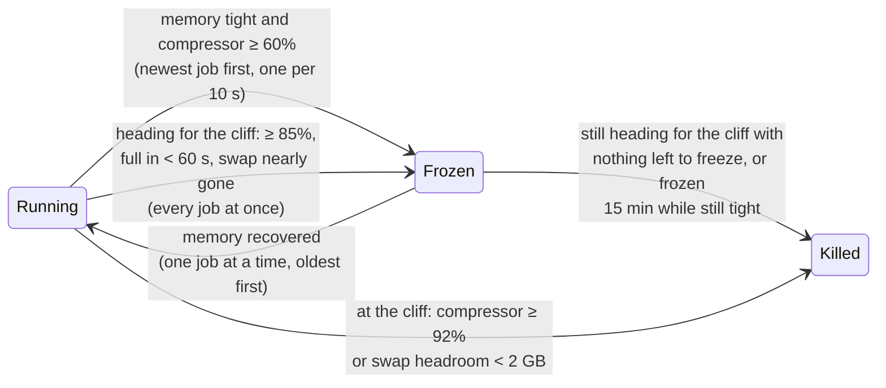

<p align="center">
  <picture>
    <source media="(prefers-color-scheme: dark)" srcset="assets/logo-dark.svg">
    <source media="(prefers-color-scheme: light)" srcset="assets/logo-light.svg">
    
  </picture>
</p>

<h1 align="center">membrake</h1>

<p align="center">
  <b>A memory brake for macOS.</b><br>
  Freezes runaway dev and coding-agent jobs before your Mac freezes. Kills only at the cliff.
</p>

<p align="center">
  <a href="https://github.com/DivMode/membrake/actions/workflows/ci.yml"></a>
  <a href="LICENSE"></a>
  
  <a href="https://builtwithnix.org"></a>
</p>

<p align="center">
  
</p>

---

## Why

Run enough parallel work on a Mac and it stops responding. Not slowly: the
cursor freezes, apps beachball, and eventually the only way out is the power
button.

We hit this on a 96 GB Mac Studio running ten coding-agent sessions and four
self-hosted CI runners. Between them they started **31 TypeScript type-checkers,
8 linters and 92 Node processes at once**. macOS compressed what it could,
swapped 75 GB to disk, and then started killing processes to survive. Its own
crash reports show exactly what it chose:

| Killed by macOS | Not killed |
|---|---|
| **2,745 processes** in one event, every one an idle system service (keychain, iCloud, accounts, Do Not Disturb, …), reason `low-swap` | **All 131** type-checkers, linters and test workers that were eating the memory |

The Mac never recovered. It had to be restarted, and everything open was lost.

### Why macOS does that

macOS ranks processes into *jetsam bands*. When the memory compressor or swap
runs short, the kernel only kills processes in **band 0** (idle daemons). A
command you start from a terminal, or that a coding agent starts for you, sits
in band 180 and is never chosen, unless a single process holds more than half
of all compressed memory. A pool of thirty similar workers never qualifies.
Apple Silicon kernels also compile out thrashing detection.

Linux solved this years ago with [earlyoom](https://github.com/rfjakob/earlyoom)
and systemd-oomd. macOS ships nothing equivalent, and the obvious knobs don't
help:

- **`nice`, QoS classes, `taskpolicy`** order the CPU, not memory.
- **The memory-pressure level** (Activity Monitor's green/yellow/red) ignores
  swap. It can read *normal* while the machine is thrashing.
- **`ulimit` RSS limits** are not enforced on macOS.
- **A fixed concurrency cap** wastes memory when the machine is idle and still
  swaps when the jobs are bigger than you guessed.

## How it works

membrake is a small daemon that samples the kernel once a second and acts on
**jobs**: process groups, which is how shells and coding agents start every
command. A type-check, a test run or a build, with all its workers, is one job.



1. **Brake.** When memory is genuinely tight and the compressor is filling, it
   freezes (`SIGSTOP`) the **newest** eligible job, then another every 10 s
   while memory keeps climbing. A frozen job stops growing; its memory is
   compressed or swapped once instead of thrashing, and nothing is lost.
2. **Brake hard.** If the Mac is heading for the cliff (compressor ≥ 85%, full
   in under a minute, or swap almost out of room), it freezes **every** running
   eligible job at once, even in the middle of the 10 s pause that follows an
   earlier freeze. Freezing is instant and loses no work, so it always comes
   before killing.
3. **Release.** When memory recovers, it resumes frozen jobs one at a time,
   oldest first, so the newest (the likeliest runaway) comes back last and they
   don't all regrow at once.
4. **Stop.** Only when the Mac is still heading for the cliff with nothing left
   to freeze, or is already at it, it kills the **biggest** eligible job, frozen
   jobs first. A job that has been frozen for 15 minutes while memory is still
   tight is killed too, whatever else is going on.
   - Heading for the cliff: `SIGSTOP`, then `SIGTERM` and `SIGCONT` so the job
     can shut down, up to 5 s of grace (`--term-seconds`), then `SIGKILL`.
   - At the cliff (compressor ≥ 92%, or swap headroom under 2 GB, with memory
     tight) the Mac has seconds left, so there is no grace by design: `SIGSTOP`,
     then `SIGKILL` at once, with no `SIGTERM`.

### What it watches

| Signal | Source | Why this one |
|---|---|---|
| Compressor occupancy | `vm.compressor.segment.*`, `vm.compressor.pages_compressed*` | The real cliff: the kernel declares memory exhausted at 98% |
| Time to full | Occupancy over the last ~10 s | Catches fast fills while occupancy is still moderate |
| Swap headroom | `statfs` on the swap volume, `vm.swapusage` | The second cliff: swap can't grow on a full disk |
| Free memory | `kern.memorystatus_level` | Gates the compressor signals: segments are freed lazily, so occupancy alone lies after a crunch |
| Pressure level | `kern.memorystatus_vm_pressure_level` | Backstop only |

### What it never touches

- Apps, app extensions and XPC services (anything inside a `.app`, `.appex` or `.xpc` bundle).
- System processes and system users (a uid below 500, unless you name the
  account with `--include-user`).
- Groups that mix users, or include a system user's process (a `sudo` inside
  a build, say).
- The coding agents themselves (`claude`, `codex`), terminals and multiplexers.
  Any process in a group counts, judged by its name, its path and its complete
  command line, so an agent run by an interpreter (`node …/codex`) protects the
  shell-led group it is part of.
- Anything it cannot inspect in full. A group with a process whose owner, path
  or arguments cannot be read is left alone.
- Users you protect with `--protect-user` (for example your CI runner account):
  never frozen, killed only if nothing else is left. This only ranks jobs that
  are eligible already; it does not make a system account's jobs eligible.

Eligibility is checked again on the group as it is, just before a kill, not
only when it was scanned. A job that has become ineligible since (it was
continued and started an agent, say) is left alone, and continued if it was
frozen.

### Built to be trusted

- Every `SIGSTOP` is written to disk **before** it is sent, the one that starts
  a kill included. If membrake stops, crashes, panics or restarts, it resumes
  every job it stopped before doing anything else, and it resumes everything if
  it ever loses sight of memory for a minute.
- A job's record is dropped only once the job is confirmed gone or `SIGCONT`
  has been sent. A resume that fails, or a job that cannot be inspected, leaves
  the record and is tried again on every sample until it works.
- Before every signal it looks at the group again and checks it is still the
  one it chose (the leader's pid and start time, or, if the leader is gone, a
  member older than the scan), so a recycled process group is never signalled.
  `SIGKILL` goes to each member by its own pid after its start time is read
  again. macOS has no `pidfd`, so a few microseconds between that last look and
  the signal remain.
- A flag that no longer parses, or an account that was deleted, stops the daemon
  only after it has resumed what a previous run froze.
- All of a sample's signals go out before anything is logged. Events go to a
  logger thread over a bounded queue; if the disk stalls they are dropped and
  counted, and the count is logged when it recovers, so a stuck log never delays
  a freeze or a kill. (The sampling thread still appends one small row to
  `samples.tsv` per sample, and flushes the state file before a `SIGSTOP`, by
  design; every `fsync` of a log is on the logger thread.) Events are copied to
  stdout only when it is a terminal: under launchd stdout is a file that
  `newsyslog` cannot rotate, and `events.log` has them all.
- Timers run on awake time, so a lid-close never makes a job look "frozen too
  long".
- `--dry-run` logs every decision and sends no signals.
- One kill in flight at a time, then a settle period before the next decision.
- The quiet sampling path (read the kernel, decide, look at each frozen job,
  record) does not allocate once it is warm; tests prove it with no job and
  with a frozen, recorded one. Acting does allocate (scanning the process table,
  signalling, logging an event). The daemon lifts itself out of jetsam band 0 so
  macOS can't kill the guard first.
- Every sample and event is recorded, and `membrake replay` runs a recording
  back through the policy, which is how the policy is tested.

## Compared with

| | Freezes before killing | Acts on whole jobs | Watches the compressor | Protects CI and apps | Language |
|---|:-:|:-:|:-:|:-:|---|
| **membrake** | ✅ | ✅ | ✅ | ✅ | Rust |
| [oomguard](https://github.com/trentshaines/oomguard) | ❌ (stops only to kill) | ✅ | ✅ | ⚠️ (terminals by name) | Swift |
| [earlyoom-rs-mac](https://github.com/haydenflinner/earlyoom-rs-mac) | ❌ | ❌ (largest process) | ❌ (pressure level) | ❌ | Rust |
| [macos-oom-guard](https://github.com/fl4p/macos-oom-guard) | ❌ | ⚠️ (after a respawn) | ❌ (`memorystatus_level`) | ✅ | Python |
| Fixed concurrency queue (`sem`, slots) | — | — | ❌ | — | — |

## Install

> **Status: early.** membrake is new. Run it with `--dry-run` for a while and
> read `/var/log/membrake/events.log` before letting it send signals.

### Nix

```sh
nix run github:DivMode/membrake -- status
```

Add `github:DivMode/membrake` as a flake input and use
`inputs.membrake.packages.aarch64-darwin.default`.

### From source

```sh
cargo install --git https://github.com/DivMode/membrake
```

### Run it as a LaunchDaemon

membrake needs root to see and signal every user's jobs. An example daemon
definition is in [`contrib/dev.membrake.plist`](contrib/dev.membrake.plist):

```sh
sudo cp contrib/dev.membrake.plist /Library/LaunchDaemons/
sudo launchctl bootstrap system /Library/LaunchDaemons/dev.membrake.plist
```

## Usage

```sh
membrake status                # live signals, frozen jobs, the next candidates
membrake run --dry-run         # watch decisions without sending any signal
membrake run                   # the daemon
membrake replay samples.tsv    # run a recording back through the policy
```

| Flag | Default | Meaning |
|---|---|---|
| `--protect-user NAME` | — | Never freeze this user's jobs; kill them only last. Ranking only: it does not make a system account eligible (repeatable) |
| `--include-user NAME` | — | Treat this system account's jobs (uid below 500) as eligible (repeatable) |
| `--prefer REGEX` | — | Freeze and kill matching jobs first |
| `--never REGEX` | agents, terminals | Never touch matching jobs (adds to the built-in list) |
| `--min-job-gb GB` | `1` | Ignore jobs smaller than this |
| `--settle-seconds S` | `10` | Spacing between freezes, resumes and kills |
| `--max-freeze-minutes M` | `15` | Kill a job frozen this long while memory is still tight |
| `--term-seconds S` | `5` | Grace between `SIGTERM` and `SIGKILL` (none at the cliff) |
| `--on-event CMD` | — | Run on every freeze, resume and kill, with `MEMBRAKE_*` variables |
| `--state-dir DIR` | `/var/db/membrake` | Where frozen jobs are recorded |
| `--log-dir DIR` | `/var/log/membrake` | `samples.tsv` and `events.log` (dry runs default to a `dry-run` subdirectory) |
| `--dry-run` | off | Decide and log, send nothing |

The demo above is `membrake replay assets/simulated-crunch.tsv`: a simulated
crunch, not a recording of a real machine, so you can run it yourself.

### Telling your agent

`--on-event` runs a command with `MEMBRAKE_EVENT`, `MEMBRAKE_PGID`,
`MEMBRAKE_BYTES`, `MEMBRAKE_COMMAND` and `MEMBRAKE_UID`, so you can notify
yourself or message the coding agent whose job was frozen.

## Limitations

- **macOS on Apple Silicon only**, and the thresholds are first estimates.
  Watch `events.log` and `samples.tsv` and tell us what you see.
- **A job in your own terminal** that membrake freezes is reported as
  `suspended` by your shell. When membrake resumes it, it carries on in the
  background; type `fg` to bring it back to the foreground. Coding agents run
  their commands without a terminal and are not affected.
- **Lifting the guard out of jetsam band 0** needs root (the LaunchDaemon). Run
  as a normal user, membrake can only request it.
- It acts on what it can see: as a normal user, only that user's jobs.

## Credits

membrake stands on [oomguard](https://github.com/trentshaines/oomguard)'s
research into what actually crashes a Mac out of memory, and on
[earlyoom-rs-mac](https://github.com/haydenflinner/earlyoom-rs-mac)'s macOS
system-call groundwork. Both are MIT licensed; see
[THIRD_PARTY_NOTICES.md](THIRD_PARTY_NOTICES.md).

## Contributing

Issues and pull requests are welcome. The policy is a pure function, so most
changes can be proven with a recorded or synthetic sample sequence in
`src/engine.rs`. **Never test by filling memory on purpose:** record a real
episode with `membrake run --dry-run` and replay it.

## License

MIT
